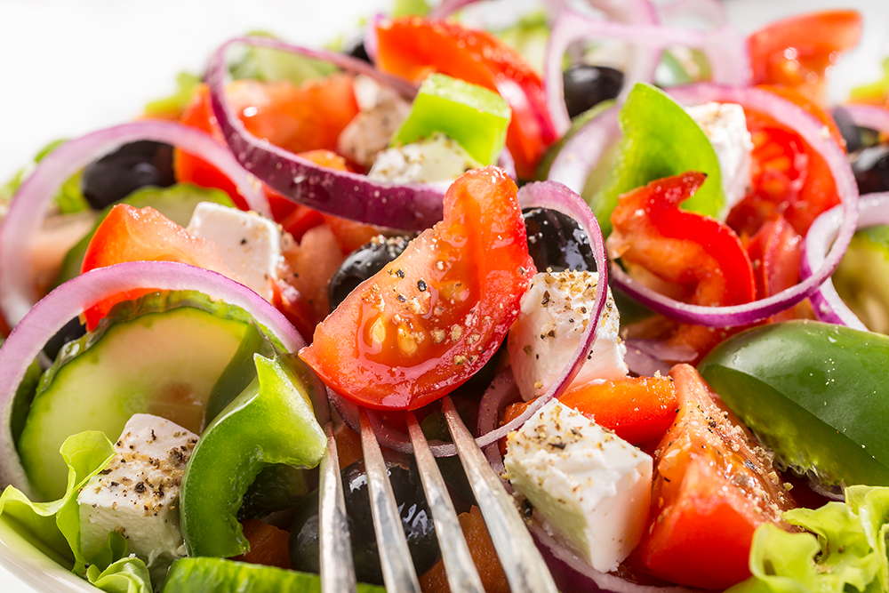

# 🍋 Little Lemon – iOS Food Ordering App


**Little Lemon** is an elegant SwiftUI iOS application for a fictional Mediterranean restaurant, built as the capstone project for the Meta iOS Developer Professional Certificate program on Coursera. The app demonstrates modern iOS development practices including **SwiftUI**, **CoreData** for persistent storage, **MVVM** architecture, and **Combine** for reactive state management.

---

## 🧱 Tech Stack

| Layer | Technology |
| --- | --- |
| **Language** | Swift 5.7+ |
| **UI Framework** | SwiftUI |
| **Architecture** | MVVM (Model-View-ViewModel) |
| **Persistence** | CoreData |
| **Networking** | URLSession + Combine |
| **IDE** | Xcode 14+ |
| **Platform** | iOS (iPhone & iPad) |
| **Assets** | Provided by Little Lemon design system (PDF wireframes & style guides) |

---

## 🎨 Design

The app is meticulously built to match the provided **wireframes** and **style guides**:

- **Style Guides**: `PG_LittleLemon_StyleGuide.pdf`, `my-style-guide.pdf`, `PG_LittleLemon_StyleGuide.pdf`
- **Wireframes**: `my-wireframe.pdf`, `Canvas_Wireframe.fig`, `Canvas_Wireframe_Final.fig`

Assets like food images, logos, and placeholders are stored in the `Little Lemon App Assets/` folder and integrated into `Assets.xcassets`. The design system includes custom fonts (`Karla`, `Markazi Text`) and a consistent color palette.

---

## 📸 Screenshots

Visual overview of the app's key screens:

| Screen | Image |
|--------|-------|
| **App Logo** |  |
| **Hero Section** |  |
| **Greek Salad** |  |
| **Bruschetta** |  |
| **User Profile** |  |
| **Restaurant** |  |

*Images sourced from `Little Lemon App Assets/` folder — included in the GitHub repository for portfolio showcase.*

---

## 🔐 Architecture

The app follows **MVVM** separation of concerns:

| Component | Responsibility |
| --- | --- |
| **Models** (`Models/`) | `MenuItem` & `MenuList` – Codable structs for JSON decoding; `Dish` – CoreData entity for persistent storage |
| **ViewModels** (`ViewModels/`) | `ViewModel` – Handles user input validation, CoreData operations, UserDefaults persistence, and encryption (`CryptoKit`) |
| **Views** (`Views/`) | SwiftUI screens: `Onboarding`, `Home`, `MainScreen`, `Menu`, `Hero`, `DetailItem`, `FoodItem`, `UserProfile` |

Key data flow: JSON menu data → `MenuList.getMenuData()` → CoreData `Dish` entities → `FetchedObjects` with predicate/sort → SwiftUI list views with filtering/toggling.

---

## ✨ Features

| Feature | Description |
| --- | --- |
| **Onboarding** | Collects user details (first name, last name, email, phone) with validation; persists login state via `UserDefaults`; navigates to Home on successful registration. |
| **Home & Menu** | Header with profile avatar; hero section with restaurant description; category toggles (starters, mains, desserts, drinks); search/filtering/sorting; scrollable dish list from CoreData. |
| **Detail Item** | Full-screen view with `AsyncImage`, title, description, price, and nutritional/descriptive text. |
| **User Profile** | Displays/edits user personal details; email encryption via `AES.GCM`; toggle settings for order statuses, password changes, special offers, newsletter; Save/Discard changes with persistent storage. |
| **CoreData Persistence** | Persistent local storage for menu items and user preferences; `clear()` method to reset data before re-fetching; `FetchedObjects` reactive wrapper for SwiftUI. |
| **Networking** | Fetches menu JSON from GitHub API (`https://raw.githubusercontent.com/Meta-Mobile-Developer-PC/Working-With-Data-API/main/menu.json`); decodes into `MenuItem` structs; maps to CoreData entities. |

---

## 📁 Project Structure

```
LittleLemonApp/
├── LittleLemonApp/                    # Xcode project folder
│   ├── Assets.xcassets/              # App icons, images, color sets
│   ├── CoreData/                     # Persistence stack & data models
│   │   ├── ExampleDatabase.xcdatamodeld
│   │   ├── Persistence.swift         # NSPersistentContainer setup
│   │   └── FetchedObjects.swift       # Reactive fetch wrapper
│   ├── Models/                       # Codable structs: MenuItem, MenuList
│   ├── ViewModels/                   # Business logic: ViewModel (validation, persistence, encryption)
│   ├── Views/                      # SwiftUI screens & components
│   │   ├── Onboarding.swift         # User registration flow
│   │   ├── Home.swift               # Entry point → MainScreen
│   │   ├── MainScreen.swift         # Header + Menu container
│   │   ├── Menu.swift               # Search, filters, category toggles, dish list
│   │   ├── Hero.swift               # Restaurant hero section
│   │   ├── Header.swift             # Top bar with profile avatar
│   │   ├── DetailItem.swift         # Single dish detail view
│   │   └── FoodItem.swift           # List row dish component
│   └── LittleLemonApp.swift        # App entry point
└── LittleLemonApp.xcodeproj/         # Xcode project file
```

---

## 🧪 Local Setup

### Requirements

- **Xcode 14+** (or newer)
- **macOS Monterey** (12+) or newer
- **Swift 5.7+**
- iOS Simulator (built-in with Xcode) or real iOS device

### Run the App

```bash
# Open project in Xcode
open LittleLemonApp.xcodeproj
```

1. Select an iOS simulator (e.g., iPhone 15, iPhone 15 Pro Max) or connect a physical device.
2. Press **Cmd+R** or click the "Play" button in Xcode to build and run.
3. The app launches on the **Onboarding Screen** – enter user details and tap **Register** to proceed to Home.

---

## 🗄 CoreData Details

- **Database**: `ExampleDatabase.xcdatamodeld` – contains `Dish` entity for menu storage.
- **PersistenceController**: Sets up the CoreData stack; `viewContext` is injected via `\.managedObjectContext` environment variable.
- **`clear()`**: Deletes all `Dish` entities from the persistent store (used before re-fetching JSON menu data).
- **`oneDish()`**: Convenience static helper that returns a sample `Dish` instance for SwiftUI previews.
- **Automatic merging**: `automaticallyMergesChangesFromParent = true` ensures UI stays in sync with background context changes.

---

## 🧪 Testing & Linting

- **Manual testing**: Full workflow verification via Xcode interface (Onboarding → Home → Menu → Detail → Profile).
- **Automated tests**: XCTest test cases can be added for `ViewModel` validation, CoreData operations, and UI interactions.
- **No formal CI setup** – manual builds in Xcode recommended for development workflow.

---

## 👤 About Me

I'm **Ongun Akay**, a mobile developer passionate about building clean, maintainable iOS applications. This project serves as my capstone portfolio piece for the Meta iOS Developer Professional Certificate, demonstrating:

- SwiftUI expertise and adaptive UI design
- CoreData persistence and data modeling best practices
- MVVM architecture with separated concerns
- JSON networking and data decoding
- Custom toggles, animations, and accessibility considerations

---

## 📄 License

This project is licensed under the **MIT License** – see the [`LICENSE`](./LICENSE) file for details.